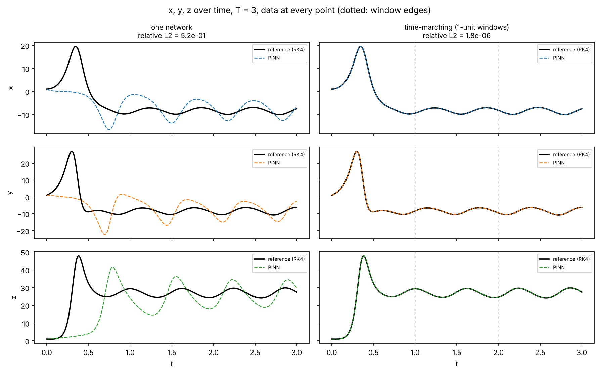
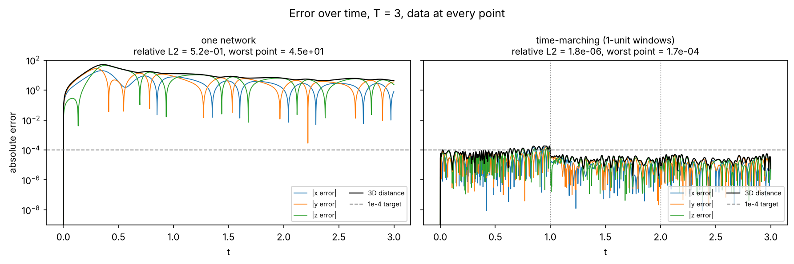
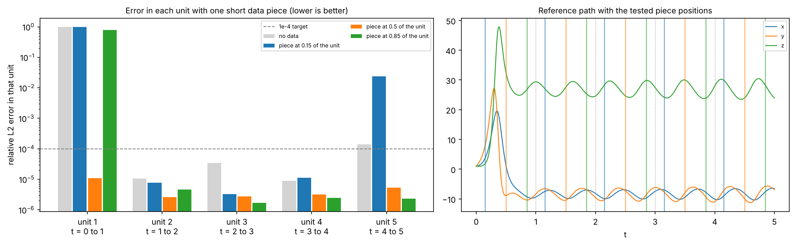
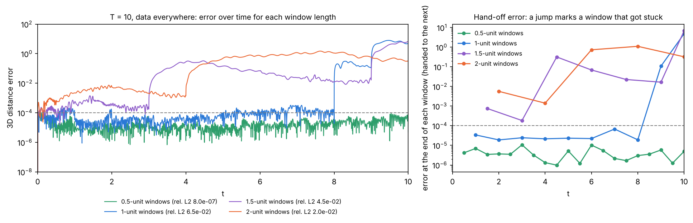
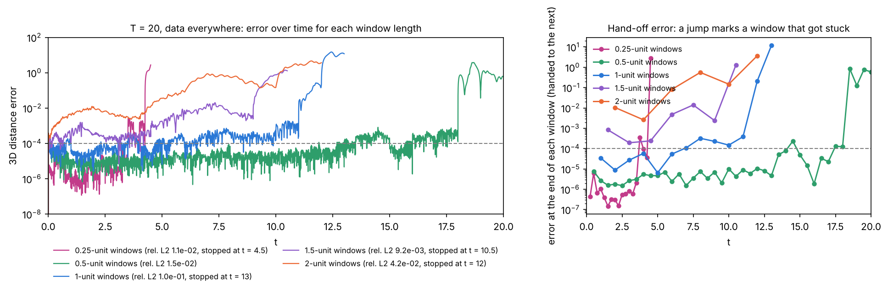
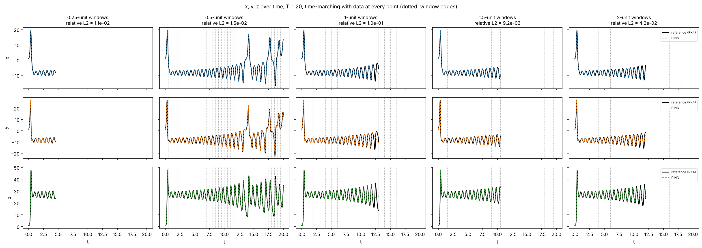
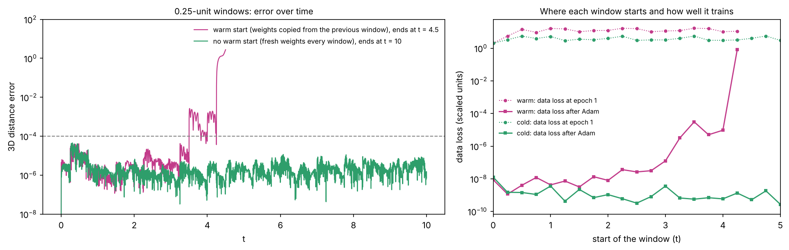

# What the three horizon graphs show

All three graphs use the same setup:

- Lorenz with σ = 10, ρ = 28, β = 8/3, starting at (1, 1, 1).
- The reference path is RK4 with dt = 1e-4.
- The PINN is 4×64 tanh in float64, with a hard initial condition. It trains with Adam for 10k epochs, then L-BFGS (up to 5000 steps).
- "Relative L2" is the whole-path error divided by the size of the path. The dashed **1e-4 target** line is the bar used throughout the report.
- One time unit is about one Lyapunov time. Over one unit, a small error grows by only about 1.3 to 1.7 times.

**Two ways of training the PINN**

- **One network:** a single 4×64 network t → (x, y, z) is trained on the whole interval [0, T] in one go. Its physics points cover all of [0, T]. It is the same tuned PINN as in the main report, just stretched over a longer T.
- **Time-marching:** a separate 4×64 network is trained for each 1-unit window, [0, 1], [1, 2] and so on, one after another.
  - Each window starts from the previous window's predicted end state.
  - Each network begins training from the previous window's weights.

Both use the same architecture, optimizer and data density. The only difference is whether one network covers all of [0, T] or each network covers one unit.

---

## 1. "One network breaks down past T = 2.5; time-marching does not"

**What is plotted**

- **x-axis:** T, the length of the time window. Every run has data at every point.
- **y-axis:** relative L2 error over [0, T], on a log scale. Each step up is 10 times worse.
- **Blue squares:** one network trained on all of [0, T], starting seed 99. The faint blue circles use seed 7, to check that the result is not luck of the starting weights.
- **Orange diamonds:** time-marching. A separate network is trained on each 1-unit window in order. Each window starts from the previous window's predicted end point and from its weights.

**The numbers**

| T | One network (seed 99) | One network (seed 7) | Time-marching |
|---|---|---|---|
| 1 | 2.5e-6 | | |
| 1.5 | 3.8e-5 | | |
| 2 | 1.6e-4 | 5.9e-5 | |
| 2.5 | 9.7e-4 | 7.9e-4 | |
| 3 | ≈ 0.5 | ≈ 0.5 | 1.8e-6 |
| 5 | not run | | 2.6e-6 |

**How to read it**

- **One network gets steadily worse, then collapses.** Its error rises about ten times for every extra half unit. It crosses the 1e-4 target near T = 2, and at T = 3 it jumps to about 0.5. An error of 0.5 means the prediction is on a different part of the attractor, not just slightly off.
- **The collapse is a training failure, not missing information.** These runs have data at every point, so the network is shown the answer and still cannot fit it. A longer chaotic path has more swings for one network to represent, and the optimizer settles into a wrong solution that partly satisfies both the data and the physics. Seed 7 lands on the same curve, so this is not bad luck.
- **Time-marching stays flat at about 2e-6, from T = 3 all the way to T = 5.** Each window is a T = 1 problem, which we already know solves to about 2.5e-6. Handing the end point to the next window adds a little error each time. Because errors grow only about 1.5 times per unit over this stretch, that added error does not snowball.
- **Takeaway:** with one network, you can trust about T ≈ 2. With 1-unit windows, the reachable T is limited by how far errors grow, not by training. We tested up to T = 5. T = 4 was not run, which is why the gap is there.

### 1a. T = 3 up close: x, y, z against the reference

**What is plotted**

- **Rows:** x, y and z.
- **Columns:** one network on the left, time-marching on the right.
- **Lines:** black is the RK4 reference and dashed is the PINN.
- **Dotted lines on the right:** the window edges at t = 1 and 2.
- **Data:** both runs have data at every point.

**How to read it**

- **The one network misses the first big swing entirely.** The reference shoots up to x ≈ 20, y ≈ 27 and z ≈ 48 between t ≈ 0.25 and 0.4. The PINN stays near its starting point and then dips the wrong way (x down to about -16 at t ≈ 0.75). Its z peak arrives about 0.4 units late.
- **After that, it settles into a wrong rhythm.** It swings with the right period of about 0.62 but with roughly twice the reference's amplitude, and it has the wrong phase. In other words, the network found a smooth, regular curve that roughly fits the slow loops on the left wing. It never captured the sharp transient at the start.
- **This is the "wrong solution" behind the 0.52 in graph 1.** The data was there at every point, but the optimizer never pulled the network onto the fast early swing.
- **Time-marching lies on top of the reference everywhere.** That includes the spike in [0, 1] and the hand-offs at t = 1 and 2, with a relative L2 of 1.8e-6. Each window only has to fit about one unit of motion, which a single 4×64 network handles easily.

### 1b. T = 3 up close: error over time

**What is plotted**

- **Lines:** the absolute error of x, y and z at each moment, plus the 3D distance in black, on a log scale.
- **Dashed line:** the 1e-4 target.

**How to read it**

- **One network (left):** the error jumps to about 1 within the first few hundredths of a unit. It peaks at 45 around t ≈ 0.35, where the swing is missed, and stays between about 3 and 20 for the rest of the run.
  - The deep downward spikes are not moments where it is right. They are moments where the wrong curve happens to cross the reference in one variable. The black 3D line never comes down.
- **Time-marching (right):** the error stays between about 1e-6 and 1e-4 for the whole run, with a worst point of 1.7e-4.
  - The first window, which contains the spike, is the hardest. Its error rides right at the 1e-4 line.
  - At t = 1 the error drops about ten times. The later windows only contain the calm left-wing loops, so they are easier to fit.
  - The hand-off at t = 2 adds no visible jump. The small error passed between windows does not grow.

---

## 2. "T = 5, time-marching: where the data sits decides the outcome"

**What is plotted**

- **x-axis:** time t from 0 to 5. The dotted lines are the window edges at 1, 2, 3 and 4.
- **y-axis:** the 3D distance between the PINN and the reference at each moment, on a log scale. The attractor is about 40 wide, so an error near 10 to 30 means the prediction is somewhere else entirely.
- **Every line is time-marching at T = 5 with seed 99.** Only the data layout changes. Physics is enforced everywhere in every case.

**The four layouts**

1. **Orange, 5% of every window:** each window has a data piece 0.05 units long, which is about 10 points.
   - The error stays between about 1e-5 and 2e-4 for the whole run, and the held-out relative L2 is 2.9e-6.
   - It is about as good as data everywhere (2.6e-6), with 95% less data.
   - Seeds 7 and 123 also worked, at 1.4e-5 and 2.2e-6.
2. **Green, 2% of every window:** a piece 0.02 units long, about 4 points per window.
   - It tracks orange until about t = 4, then creeps up to about 2e-3 by t = 5. The relative L2 is 1.2e-5 and the worst point is 2.4e-3.
   - It still works overall, but this is close to the floor. A tiny anchor per window lets small errors build up.
3. **Purple, 5% of every other window:** windows 2 and 4 have no data.
   - The error climbs during the empty windows and steps up at t = 3 to about 1e-3. It peaks near 6e-3 around t = 4, then settles a little once window 5 has data again.
   - With seed 99 this run survived, at 6.4e-5. **With seed 7 it failed**, so skipping windows is unreliable.
4. **Blue, data on [0, 1] only:** windows 2 to 5 have physics only.
   - Window 1 is fine. Through window 2 the error drifts up to about 3e-4.
   - **Right at t = 2 it jumps to about 1e-2** and climbs to about 0.3. **At t = 3 it jumps again, to about 20**, which means it is on the wrong path. It stays there.

**How to read it**

- **Every window needs some data.** A small piece is enough, but a window with none is a gamble.
- **The failures are sudden jumps, not slow drift, and they happen at window edges.** At t = 2 the hand-off error was only about 3e-4. If the growth were only from chaos (about 1.5 times per unit), it would stay near 1e-3. Instead it jumps more than 30 times within a fraction of a unit. My reading is that a window trained on physics alone does not reliably follow the equation from its starting point, and the optimizer finds another curve that also keeps the residual small. Even a few data points rule those curves out. This is an inference from the shape of the curves; I did not run a separate test for it.
- **Once a window lands on the wrong path, the next window inherits that wrong start.** Every later window then follows the wrong path faithfully, so the error never comes back down.

---

## 3. "T = 5: how far apart the data can be"

**What is plotted**

- **x-axis:** the time between data pieces. Each piece is 0.05 long, so 0.5 means pieces at 0.5, 1.0, 1.5 and so on. All runs are time-marching at T = 5.
- **y-axis:** error measured only on the **held-out** points, meaning the points with no data. This makes it a test of prediction, not of fitting.
- **Blue circles:** relative L2. **Orange squares:** worst single held-out point (largest absolute error in x, y or z).
- **Gray crosses:** the same spacing, but with the first piece starting late, at t = 0.75 for the 1.5 spacing and t = 1.0 for the 2.0 spacing.

**The numbers**

| Spacing | First piece at | Relative L2 | Worst point | Outcome |
|---|---|---|---|---|
| 0.5 | 0.5 | 1.2e-5 | 2.3e-3 | works |
| 1.0 | 0.5 | 1.0e-5 | about 9e-4 | works |
| 1.5 | 0.5 | 2.3e-3 | about 0.23 | held through three gaps, broke between t = 4 and 5 |
| 2.0 | 0.5 | 0.30 | about 20 | broke around t = 2.5 |
| 1.5 | 0.75 | about 0.5 | | fails |
| 2.0 | 1.0 | about 0.5 | | fails |

**How to read it**

- **A gap of 1 unit or less is safe, 1.5 is borderline, and 2 fails.** A spacing of 1 or less means every 1-unit window gets at least one piece, which is the same rule graph 2 found.
- **Spacing 0.5 is no better than 1.0.** Twice the data buys nothing once every window has an anchor, so data spacing matters more than amount. The small difference between the two worst-point values is run-to-run noise.
- **The relative L2 is under 1e-4 at both safe spacings, but the worst point is not.** The prediction is excellent on average but can have short spikes up to about 1e-3, usually just before the next piece of data.
- **At 1.5, window 5 only gets data at its very end.** The pieces sit at 0.5, 2.0, 3.5 and 4.95 to 5, so every window touches some data. But window 5 is unanchored from t = 4 to 4.95, and its end error jumps from 1e-4 to 0.1. Data that arrives late in a window doesn't save it.
- **At 2.0, window 2 has no data at all, and window 3 has a piece at its middle (t = 2.5).**
  - Window 2 survived, with an end error of 4e-4.
  - Window 3 broke anyway, with an end error of 0.18. My guess is that window 3 inherited weights from window 2, which had no data, and that this led it astray; that is inferred.
  - From there the run is on the wrong path. End errors per window were 3e-4, 4e-4, 0.18, 27 and 7.8.
- **The gray crosses show that the first unit needs data early.** With the same spacings but a later first piece, both runs fail outright. The first unit holds the big transient: x rises to about 20 and z to about 48 around t = 0.3 to 0.4, and the path switches wing at t ≈ 0.51. A piece near t = 0.25 to 0.5 pins that down. Without it, window 1 can leave the path before any data arrives.

---

## The three graphs together

1. One network cannot be trained much past T ≈ 2, even with perfect data, so split time into 1-unit windows.
2. With windows, you need very little data: a 0.05-long piece per window (5%) is as good as full data.
3. What matters is that **every window has at least one piece (spacing of 1 unit or less)** and that **the first piece lands early, around t ≈ 0.25 to 0.5**. Missing either one causes a sudden jump onto the wrong path, not gradual drift.

**Caveats:** most of these are single runs with seed 99. The "every other window" case already showed that a seed can flip the outcome. The next graph will test which position inside each unit (start, middle or end) matters most. It is running now.

---

## 4. Which part of each unit matters most

**The test**

- Each 1-unit window of the T = 5 path is trained **on its own, starting from the true state** at the start of the unit. This keeps windows from affecting each other.
- Physics covers the whole unit. The window gets either no data, or one 0.05-long data piece (about 10 points) centered at 0.15, 0.5 or 0.85 of the way through.
- That makes 5 units × 4 options = 20 runs, all with seed 99 and L-BFGS capped at 1000. The script is `scripts/unit_placement.py` and the results are in `unit_placement.csv`.
- **Left:** each unit's relative L2 error, on a log scale. **Right:** the reference path, with the tested piece positions marked.

**Relative L2 error per unit**

| Unit | No data | Piece at 0.15 | Piece at 0.5 | Piece at 0.85 |
|---|---|---|---|---|
| 1 (t = 0 to 1) | 0.99 | 0.99 | **1.1e-5** | 0.78 |
| 2 (t = 1 to 2) | 1.1e-5 | 7.6e-6 | 2.6e-6 | 4.6e-6 |
| 3 (t = 2 to 3) | 3.4e-5 | 3.3e-6 | 2.7e-6 | 1.7e-6 |
| 4 (t = 3 to 4) | 8.9e-6 | 1.1e-5 | 3.2e-6 | 2.5e-6 |
| 5 (t = 4 to 5) | 1.4e-4 | 2.4e-2 | 5.3e-6 | 2.3e-6 |

**Error at the end of the unit (what gets handed to the next window)**

| Unit | No data | 0.15 | 0.5 | 0.85 |
|---|---|---|---|---|
| 1 | 32 | 32 | 1.8e-4 | 8.5 |
| 2 | 4.5e-4 | 2.2e-4 | 7.0e-5 | 1.3e-4 |
| 3 | 9.0e-4 | 1.0e-4 | 7.1e-5 | 3.6e-5 |
| 4 | 1.8e-4 | 4.2e-4 | 1.4e-4 | 3.9e-5 |
| 5 | 5.1e-3 | 1.1 | 5.6e-5 | 4.1e-5 |

**How to read it**

- **Unit 1 is the one that matters, and only its middle works.**
  - The piece at 0.15 sits before the big swing (t ≈ 0.25 to 0.4). The piece at 0.85 sits well after it.
  - Both fail as badly as no data at all.
  - Only the piece at 0.5 works. It sits right where the swing comes down and the path switches wing (t ≈ 0.51). It is the one spot that tells the network how big the swing was and which wing it lands on.
  - This matches the gap test, where runs whose first piece came at 0.75 or later failed.
- **Units 2 to 4 (the calm loops) are easy.**
  - Starting from the true state, they work even with no data, all at 3.4e-5 or less.
  - A piece still helps by about 3 to 10 times, and **later is slightly better**. A piece at 0.85 gives the smallest end error, and the end error is exactly what the next window inherits.
- **Unit 5 is less stable.**
  - With no data it is borderline, at 1.4e-4.
  - With a piece at 0.15 it failed (2.4e-2, end error 1.1), while 0.5 and 0.85 were fine.
  - That 0.15 failure is a single run. My guess is that it is an unlucky optimizer run rather than an early piece hurting, but I haven't tested that.
- **Rule of thumb:** put each unit's data in the **middle to late part** of the unit, around 0.5 to 0.85.
  - For the first unit it **must be near the middle**, right after the big swing.
  - Late pieces keep the hand-off error small, which is what protects the later windows.

**Caveats:** each window here starts from the true state. In real time-marching it starts from the previous prediction, so this test shows what each unit needs in the best case. All runs use one seed and L-BFGS capped at 1000.

---

## 5. Is one network per time unit a rule? T = 10 with different window lengths

**The test**

- Time-marching at T = 10 with data at every point.
- Window lengths of 0.5, 1, 1.5 and 2 units.
- Everything else is fixed: data and physics points per unit, Adam for 10k epochs then L-BFGS up to 5000 steps, seed 99, and starting each window from the previous window's weights.
- Results are in `t10_windows.csv`.

**What is plotted**

- **Left:** the 3D error over time for each window length, on a log scale.
- **Right:** the error at the end of each window. That is the starting point the next window inherits. A sudden jump marks a window whose training got stuck.

| Window length | Relative L2 | Worst point | First stuck window | Off the path from |
|---|---|---|---|---|
| 0.5 | 8.0e-7 | 8.7e-5 | none | never (all 20 hand-offs at 1e-5 or less) |
| 1 | 6.5e-2 | 7.3 | window 9, [8, 9] | t = 8 |
| 1.5 | 4.5e-2 | 5.8 | window 3, [3, 4.5] | t = 3 |
| 2 | 2.0e-2 | 1.5 | window 3, [4, 6] | t = 4 |

The relative L2 values don't rank the failures well. The 2-unit run has the smallest value but goes off the path earliest after the 1.5-unit run. Its error just stays at about 1 rather than climbing to 5 to 7, so read the "Off the path from" column, not the relative L2.

**How to read it**

- **Shorter windows are more reliable, and none of the longer ones is guaranteed.** Only the 0.5-unit windows reach T = 10 cleanly. One-unit windows hold for 8 units, which is why they looked safe at T = 3 and 5, and then a single window gets stuck. The 1.5- and 2-unit windows get stuck by their third window.
- **Longer windows are also less accurate before they fail.** In the first window, which contains the big swing, the error handed on is about 4e-6 with 0.5-unit windows, 3e-5 with 1-unit, 8e-4 with 1.5-unit and 6e-3 with 2-unit. That matches the one-network results, which got steadily worse from T = 1 to T = 2.5.
- **Each failure starts right at a window's start.** Every window that got stuck was handed a good starting point: 2e-5 for the 1-unit run at t = 8, and 2e-4 to 1e-3 for the others. Its data covered the whole window, yet its data loss stayed high (for example 1.4e-2 after Adam for window 9 of the 1-unit run, against 4e-5 for window 8). So this is the same training failure as the T = 3 one-network run, not chaos amplifying a small error.
- **One stuck window ruins the rest of the run.** The next window's start is fixed exactly to the bad end point, while its data shows the true path. It cannot satisfy both, so the error never comes back down.

**Answer to "is one network per unit a rule?"** No. The rule is **keep each window short**. One unit happened to be short enough for T = 5. At T = 10, with ten chances for a window to get stuck, 0.5 units was needed.

My explanation for why short windows help is an inference. Each window has less motion to fit, so Adam rarely gets stuck, and the chance that at least one window gets stuck grows with the number of windows.

**Caveats and possible fixes**

- All of this comes from one seed per window length. A different seed could move where the 1-unit run gets stuck, or avoid it.
- Two fixes would make the chain sturdier at any window length. Neither has been built yet:
  1. Check each window's final loss and retrain it with fresh weights if the loss stays high.
  2. Let the data correct the starting point (a soft starting condition) instead of fixing it exactly to the previous prediction.

---

## 6. T = 20: testing "the longer the time, the shorter the windows"

**The test**

- This is the same setup as T = 10, with data at every point, but at T = 20 and with window lengths of 0.25, 0.5, 1, 1.5 and 2.
- Each run stops early once a window ends more than 1 off the path (`--stop-above 1`), so some curves end before t = 20.
- The "off the path from" column is the first time the 3D error goes above 0.1.

| Window length | Windows trained | Off the path from | Run ended at |
|---|---|---|---|
| 0.25 | 18 of 80 | t = 4.3 | 4.5 (stopped) |
| 0.5 | 40 of 40 | t = 18.0 | 20 |
| 1 | 13 of 20 | t = 11.6 | 13 (stopped) |
| 1.5 | 7 of 14 | t = 9.2 | 10.5 (stopped) |
| 2 | 6 of 10 | t = 6.0 | 12 (stopped) |

The relative L2 values on the graph are only over the part each run reached, so they can't be compared across runs. Use the "off the path from" column instead.

**How to read it**

- **From 2 units down to 0.5 the theory holds.** Shorter windows stay on the path longer (2 → 6, 1.5 → 9, 1 → 11.6, 0.5 → 18), and shorter windows also hand on smaller errors (right panel).
- **It breaks at 0.25.** The 0.25-unit run was the most accurate while it lasted, with hand-off errors of about 1e-6. Then window 18, [4.25, 4.5], got stuck. That window is a calm loop, it was handed an error of only 4e-5, and it had data everywhere. Its data loss stayed at about 0.8 through all of Adam, and L-BFGS gave up after 7 steps. There seems to be a sweet spot rather than "shorter is always better". My guesses for why, untested:
  1. There are 80 windows, so 80 chances to get stuck.
  2. Each window rescales its outputs by the spread of x, y and z inside the window. In a very short window that spread is tiny (x varied by only about 0.4 in window 18), which makes the training problem badly scaled.
- **T = 20 reaches the wing switches.** Up to t ≈ 13.5 the path only loops around the left wing. From then on it switches wings at t ≈ 13.55, 14.34, 17.24, 18.07 and 18.85.
  - The 0.5-unit run got through the first three switches with errors up to about 8e-4.
  - It got stuck in the window that holds the switch at 18.07.
  - So longer horizons are harder partly because they reach this fast part of the attractor, not only because there are more windows.
- **Where a run breaks varies from run to run.** At T = 10, 1-unit windows got stuck at t = 8. At T = 20, with the same settings and seed, they got past that point and broke at t = 11.6. The 1.5-unit run broke at t = 3.5 at T = 10 but at t = 9.2 here. So a single run per setting tells you roughly how reliable a window length is, not exactly where it fails. One possible reason is that the first runs here briefly shared the processor with another run, which makes training not exactly repeatable. That is a guess.

**Answer:** "the longer the time, the shorter the windows" holds from 2 units down to 0.5, but it is not unlimited. 0.25-unit windows failed early, and even 0.5 broke at t = 18. Every failure was a single window whose training got stuck, so the more robust fix is to **detect a stuck window (high final loss) and retrain it** before moving on, rather than just shrinking the windows. That has not been built yet.

---

## 7. Why the 0.25-unit windows failed: the warm start

- **What a warm start is:** each window's network starts training as a copy of the previous window's trained network instead of from random weights. The window's starting point (x, y, z) is always the previous window's predicted end, either way.
- **The evidence in the logs:**
  - Warm-started 0.25-unit windows began at a data loss of 10 to 17, worse than fresh weights (about 2 to 6).
  - Their data loss after Adam crept up from about 1e-8 to 1e-5 over windows 14 to 17.
  - Window 18 then stalled at 0.8.
  - A 0.25-unit window covers less than half a loop (one loop takes about 0.62 units), so neighbouring windows don't look alike.
- **The test:** the same 0.25-unit windows at T = 10 with `--no-warm-start`.
  - It went all the way to t = 10, with a relative L2 of 1.6e-7, a worst point of 4.6e-5 and every hand-off under 5e-6. That makes it the most accurate long run so far.
  - It took 171 minutes. Losses per window are in `warm_vs_cold_losses.csv`.
- **Conclusion:** the warm start, not the short window, broke the 0.25-unit run. It is still untested whether the warm start also caused the stuck windows at longer window lengths.
